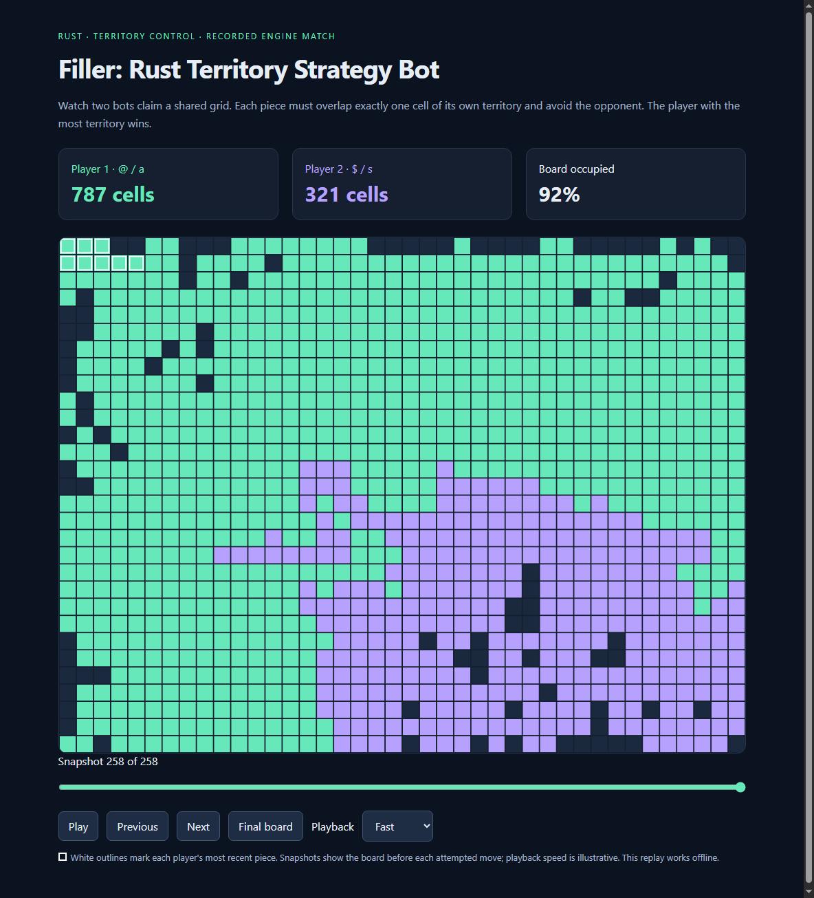

# Filler: Rust Territory Strategy Bot

A territory strategy project built in Rust. Two bots compete to occupy a shared grid, placing randomly shaped pieces and expanding their territory until no more moves are possible.

I built the Rust bot, an offline graphical replay viewer, and a command-line match runner. The game engine, maps and reference opponents are supplied exercise assets.

**Live Demo:** [View the application](https://filler-replay.vercel.app)



## How to play

The bots play automatically. On each turn, the engine sends the current board and a new piece to the active bot, which responds with placement coordinates.

- A piece must overlap **exactly one cell** of the bot's existing territory.
- It must avoid the opponent's territory, and all occupied cells must stay inside the board.
- If one bot runs out of moves, the other can continue expanding.
- The player occupying the most cells at the end wins.

## Features

- Rust bot that plays as either Player 1 or Player 2.
- Three supplied maps and four reference opponents, including `terminator`.
- Browser replay viewer with playback, frame navigation, a timeline and a final-board view.
- Command-line match runner for batches across the supplied maps, opponents and both player positions.
- Docker environment for building and running the supplied Linux game engine.

The Rust tools use the standard library without external crates. The replay viewer uses HTML, CSS and JavaScript and works offline.

## Getting started

Install Docker with Linux containers enabled. Run these commands from the repository root to build the image and start a match:

```sh
docker build --platform linux/amd64 -t filler docker_image
docker run --rm filler -c './linux_game_engine -f maps/map01 -p1 solution/target/release/filler -p2 linux_robots/h2_d2'
```

The engine prints the board as the bots play, followed by the final scores. Add `-q` to the engine command for quieter output.

To play as Player 2 against `terminator`:

```sh
docker run --rm filler -c './linux_game_engine -f maps/map00 -p1 linux_robots/terminator -p2 solution/target/release/filler'
```

Change the map or opponent path to try another matchup:

| Maps | Reference opponents |
| --- | --- |
| `map00`, `map01`, `map02` | `wall_e`, `h2_d2`, `bender`, `terminator` |

## Watch a replay

Download or clone the repository, then open [docs/demo.html](docs/demo.html) in your browser. The included replay lets you follow a game without building the project.

Use **Play**, **Previous**, **Next**, the timeline slider or **Final board** to explore the match. You can also adjust the playback speed.

To generate a replay from your own match, follow the [replay instructions in the development guide](DEVELOPMENT_GUIDE.md#generate-a-graphical-replay).

## Repository layout

```text
docker_image/
  Dockerfile          Build and run environment
  linux_game_engine   Supplied game engine
  linux_robots/       Reference opponents
  maps/               Starting boards
  solution/
    src/              Rust bot, match runner and replay generator
    assets/           Replay viewer template
    tests/            Bot and protocol tests
docs/
  demo.html           Standalone replay
  demo.png            Replay screenshot
```

See [DEVELOPMENT_GUIDE.md](DEVELOPMENT_GUIDE.md) for local development, running match batches and creating replays. The original requirements are in [Project-specs.md](Project-specs.md) and [audit.md](audit.md).
